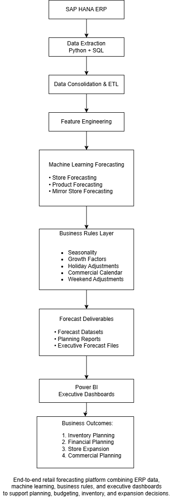
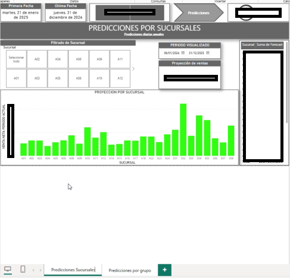
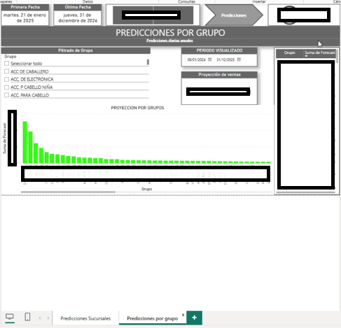

# Enterprise Retail Forecasting & Store Expansion Planning Platform

Enterprise analytics solution designed to support sales forecasting, inventory planning, budgeting, and store expansion decisions through machine learning and business-driven forecasting methodologies.

**Data Engineering + Forecasting + Business Intelligence + Retail Planning**
---

## Executive Summary

This project presents an end-to-end retail forecasting and planning platform built to transform transactional ERP data into actionable business insights.

The solution integrates automated data extraction, forecasting models, business rules, and executive dashboards to support commercial planning, inventory allocation, financial budgeting, and new store expansion initiatives.

Rather than focusing exclusively on machine learning models, the platform combines data engineering, forecasting, retail planning, and business intelligence into a single decision-support ecosystem.

---

## Business Problem

Retail organizations must continuously answer critical planning questions:

- How much will each store sell in the coming months?
- How should inventory be distributed?
- What sales volume can be expected from new stores?
- Which product groups will experience growth?
- How can budgets be built more accurately?

Traditional manual analysis often leads to inconsistent planning and limited scalability.

This platform was designed to provide a standardized, data-driven forecasting methodology.

---

## Business Value

The platform enabled:

- Automated consolidation of commercial information
- Forecast-driven planning processes
- Store-level and category-level sales projections
- Support for expansion planning initiatives
- Executive visibility through interactive dashboards
- Data-informed commercial decision making

---

## Solution Architecture

*End-to-end retail forecasting platform combining ERP data, machine learning, business rules, and executive dashboards to support planning, budgeting, inventory, and expansion decisions.*

## Technologies

- Python
- SAP HANA
- Pandas
- NumPy
- TensorFlow
- Keras
- Scikit-Learn
- Power BI
- Excel

---

## Key Capabilities

## Dashboard Examples

## Project Scope

The platform supported:

- Store-level forecasting
- Product group forecasting
- Expansion planning scenarios
- Commercial budgeting workflows
- Inventory planning processes
- Executive decision support

The solution integrated transactional ERP data, machine learning forecasting models, business rules, and executive reporting into a unified planning environment.

### Store-Level Forecasting Dashboard

*Executive dashboard used for store-level forecasting and planning. Commercial information has been anonymized.*

### Product Group Forecasting Dashboard

*Category-level forecasting dashboard supporting inventory and commercial planning decisions. Commercial information has been anonymized.*

### Sales Forecasting

Retail demand forecasting at store and product-group levels using machine learning methodologies.

### Store Expansion Planning

Mirror Store methodology for estimating sales performance in new locations based on comparable stores and growth assumptions.

### Executive Reporting

Interactive Power BI dashboards designed for commercial planning, budgeting, and operational decision support.

## Mirror Store Methodology

The platform incorporated a mirror-store methodology to estimate expected performance for new store openings and relocations.

./assets/mirror_store_methodology.png

Comparable stores were selected based on business knowledge, historical performance, and operational similarity. Forecasts were then adjusted using business assumptions and growth expectations to create an initial planning baseline.

### Business Rules Integration

Incorporation of seasonality, holiday adjustments, growth assumptions, and operational constraints into forecasting outputs.

## Validation Approach

Forecast performance was evaluated through operational comparison against actual sales results as new periods became available.

Forecast outputs were incorporated into inventory planning, commercial budgeting, and store expansion processes through executive dashboards and operational reviews.

Due to confidentiality constraints, historical evaluation reports and proprietary performance metrics are not included in this public portfolio version.
---
## Project Highlights

- End-to-end forecasting platform
- SAP HANA integration
- Automated ETL processes
- Machine learning forecasting models
- Product group demand forecasting
- Store-level forecasting
- New store planning through Mirror Store methodology
- Executive Power BI dashboards
- Commercial and financial planning support

## Business Impact

./assets/business_impact.png

The forecasting platform transformed traditional planning processes by providing a standardized, data-driven methodology for forecasting, inventory planning, budgeting, and store expansion decisions.

Key benefits included:

- Improved visibility into future sales performance
- Better inventory allocation decisions
- Support for commercial budgeting processes
- Reduced reliance on manual forecasting methods
- Standardized planning across locations
 
## Confidentiality Notice

This repository is a portfolio version of a real-world enterprise forecasting solution.

All sensitive information has been removed or anonymized, including:

- Company names
- Store identifiers
- Database structures
- ERP configurations
- Internal infrastructure details
- Commercially sensitive metrics

---

## Future Enhancements

- MLOps deployment
- Automated retraining pipelines
- Promotion-aware forecasting
- Probabilistic forecasting
- Inventory optimization models
- Forecast monitoring and alerting

---

## Author

Marco Arciba

Analytics & AI Leader | Turning Data into Business Decisions
